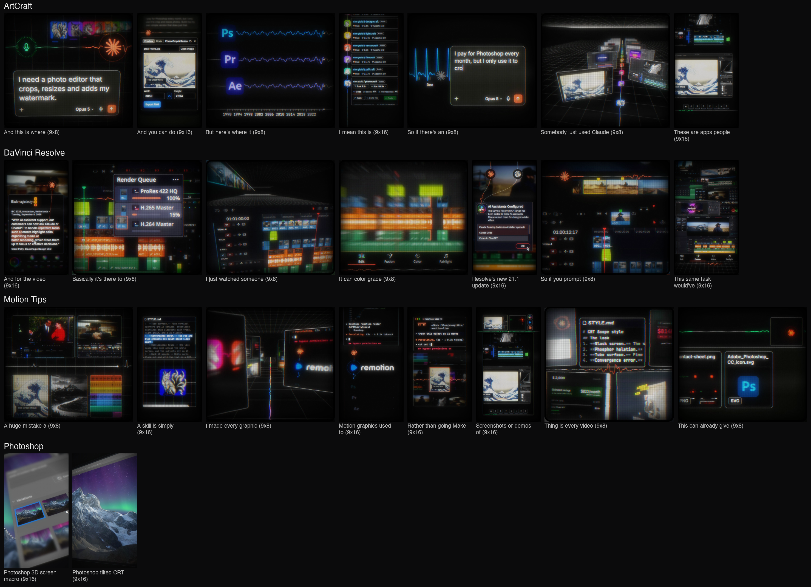

# CRT Remotion

Victor's CRT motion style for Remotion. It covers real UI and data played through a color CRT tube, and a "3D screen" macro look filmed off a tilted monitor with a handheld camera. This repo holds the style guide, the working source for every graphic built with it, the assets they use, and the finished videos as references.



- **Style guide:** [`SKILL.md`](SKILL.md). It works as a Claude Code skill if you drop the repo into `~/.claude/skills/crt-remotion`.
- **Reference videos:** [`renders/`](renders), 24 MP4s, each named by the script line it covers.
- **Builder briefs and rules:** [`docs/reels/`](docs/reels).
- **Prompt bank (reusable build prompts):** [`docs/prompt-bank/`](docs/prompt-bank).
- **Original style card (Fish 8, Sep 30 2026):** [`references/crt-scope-origin/`](references/crt-scope-origin).

## Run it

```bash
npm install
npm run dev                      # Remotion Studio, comps grouped by reel
npx remotion render PsMacro out/PsMacro.mp4 --codec=h264 --crf=16 --concurrency=1
npm run qa -- out/PsMacro.mp4    # black, brightness-dip and frozen-frame checks
```

Render one composition at a time.

## The videos

| Reel | Video | Comp | Format |
|---|---|---|---|
| ArtCraft | Somebody just used Claude (hook) | `AcP1Hook` | 9:8 |
| ArtCraft | These are apps people | `AcP2SameShortcuts` | 9:16 |
| ArtCraft | But here's where it | `AcP3ThirtyYears` | 9:8 |
| ArtCraft | I mean this is | `AcP4OpenSource` | 9:16 |
| ArtCraft | So if there's an | `AcP5PayMonthly` | 9:8 |
| ArtCraft | And you can do | `AcP6NoCode` | 9:16 |
| ArtCraft | And this is where | `AcP7WhereHeading` | 9:8 |
| DaVinci Resolve | I just watched someone (hook) | `DrP1Hook` | 9:8 |
| DaVinci Resolve | Resolve's new 21.1 update | `DrP2Connect` | 9:16 |
| DaVinci Resolve | So if you prompt | `DrP3Highlight` | 9:8 |
| DaVinci Resolve | This same task would've | `DrP4Hours` | 9:16 |
| DaVinci Resolve | It can color grade | `DrP5CanDo` | 9:8 |
| DaVinci Resolve | And for the video | `DrP6Ceo` | 9:16 |
| DaVinci Resolve | Basically it's there to | `DrP7OffYourPlate` | 9:8 |
| Motion Tips | I made every graphic (hook) | `MtP1Hook` | 9:8 |
| Motion Tips | Motion graphics used to | `MtP2Remotion` | 9:16 |
| Motion Tips | Thing is every video | `MtP3LookDifferent` | 9:8 |
| Motion Tips | A skill is simply | `MtP4Skill` | 9:16 |
| Motion Tips | A huge mistake a | `MtP5Movement` | 9:8 |
| Motion Tips | Rather than going Make | `MtP6Direction` | 9:16 |
| Motion Tips | This can already give | `MtP7References` | 9:8 |
| Motion Tips | Screenshots or demos of | `MtP8MoreRefs` | 9:16 |
| Photoshop | Photoshop tilted CRT | `PsTiltCrt` | 9:16 |
| Photoshop | Photoshop 3D screen macro | `PsMacro` | 9:16 |

The Photoshop macro piece follows the camera language of the first ten seconds of videolancer's ["Creating a 3D Screen in Premiere Pro"](https://www.youtube.com/watch?v=lEHHQ_Rhnkk): tilted macro close-ups, shallow focus, live typing and a click, cuts that rack in. That video is linked here, not included.

## Third-party material

- **App and product imagery:** each `public/<reel>/SOURCES.md` lists where it came from. This includes Adobe's Photoshop store screenshot, Blackmagic Design press shots, ArtCraft site captures, and official logos.
- **Past client graphics:** `MtP3LookDifferent` shows Victor's past client brand-deal graphics as examples.
